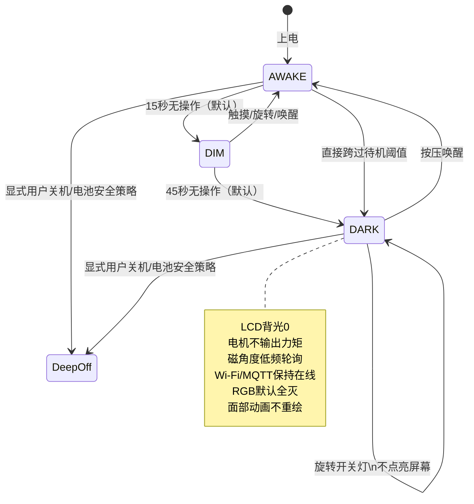
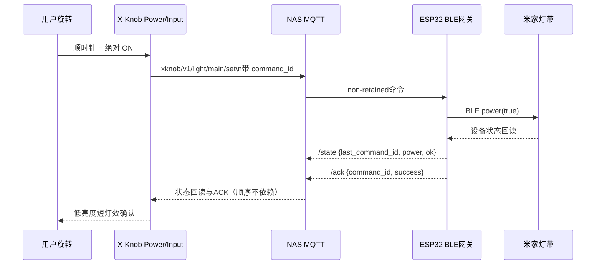

# X-Knob · Always Ready 12h — 全场景软件优化与实施规范

> 修订版：Software Optimization v3 / 2026-10-24  
> 输入：用户提供的 `X-Knob.zip` 与 `Smartled-esp32.zip`，以及此前确认的 Electron Face V4.8 交互视觉方向、方向式开关方案 A。  
> 目标：**只改软件**；电池优先，争取至少连续 12 小时；黑屏时也能不按压直接转动开关灯；Mac Codex 的提醒有用、安静、可靠。  
> 状态：含**可应用的源文件覆盖层、主机侧验证过的逻辑**；未在真实 ESP32-S3 上编译烧录、测电流、验证 BLE/MQTT 端到端时延。**12 小时是目标，不是已实现的实测结果。**

---

## 0. 从产品体验出发，先做减法

- **第一优先级：开/关灯。** X-Knob 的默认电子脸主页：顺时针＝开，逆时针＝关。*方向对应绝对目标，绝不按圈数执行 toggle。*
- 第二优先级：电池 12 小时目标下，设备**45 秒后黑屏但保持可旋转直接控灯**；默认没有自动深度关机。
- 第三优先级：旋钮的按压较硬、容易连带旋转，因此按压不再是开关灯的必经步骤，长按旋转误触要在底层统一抑制。
- 第四优先级：可爱电子脸、场景和少量重要 Codex 通知不打断旋钮控灯。
- 去除低价值开销：长时间彩虹底灯、黑屏时 LVGL 反复重绘、每次 Codex 工具调用都启动 Python 进程、静态状态重复 MQTT 发布。
- **不盲目重写成熟底层**：继续复用原项目的 PageManager、SimpleFOC、MIoT BLE 驱动、网关去重协议、SceneStore。

### 电池目标如何计算

600mAh / 12h = **50mA 理论平均整机电池电流**。考虑电池可用容量、转换效率及使用比例，建议**先以 35–40mA 为总平均电流的测量目标**；READY DARK 的电流应尽可能低，建议争取 20–30mA 级，但无法保证在此 PCB/持续 Wi-Fi 条件下实现。

| 实测平均电流 | 理想 600mAh 续航（仅数学估计） | 12h 判断 |
|---:|---:|---|
| 25mA | 24h | 预留空间大 |
| 35mA | 17.1h | 预留空间较好 |
| 40mA | 15h | 可争取 12h |
| 50mA | 12h | 理论边缘，实际往往不足 |
| 65mA | 9.2h | 软件优化后仍需要权衡使用习惯 |
| 100mA | 6h | 不满足 |

**注意：** Wi-Fi 连通的 ESP32-S3 加上开发板稳压、电机驱动、RGB 像素静态功耗，未必能以软件降到目标。不能把 ESP32 芯片数据手册的休眠电流直接当成整个 X-Knob 的电流。

---

## 1. 新的交互合同

| 上下文 | 物理操作 | 软件行为 | 电机与视觉 |
|---|---|---|---|
| 电子脸亮屏 | 顺时针跨有效档位 | 设置灯带 `power=true`（幂等） | 一个轻而清晰的档位；仅确认状态变化时表情回应 |
| 电子脸亮屏 | 逆时针跨有效档位 | 设置 `power=false`（幂等） | 同等档位；轻闭眼反馈 |
| 电子脸亮屏 | 继续同方向转 | 目标状态不变时不重复下发 | 无重复强震、无反复庆祝 |
| 电子脸亮屏 | 单击 | 进入亮度精调（灯关闭时先提示旋转开灯） | 轻确认；**单击不直接切开关** |
| 亮度精调 | 旋转 | 调亮度 | 细密档位，与主页开关手感不同 |
| 亮度精调 | 单击 | 亮度 / 色温切换 | 一个小台阶 |
| 色温精调 | 旋转 | 改色温（2700K~6500K） | 柔和档位，不需要按住旋钮再旋转 |
| 主页 | 长按 ~1.2s | 场景菜单 | 清晰的离散档位；返回可长按 |
| 场景菜单 | 旋转 / 单击 | 选择 / 应用预设 | 只有单击应用才更改灯带实际设定 |
| 主页 | 双击 | 高级菜单 | 稍强档位；不是高频操作 |
| 场景编辑 | 修改亮度/色温 | **仅修改预设**，保存成功才生效于下一次选用 | 不实时改房间灯光 |
| 黑屏 READY DARK | 顺时针有效旋转 | 开灯，**不点亮 LCD** | 低功耗、LED 可短促确认；没有持续电机力反馈 |
| 黑屏 READY DARK | 逆时针有效旋转 | 关灯，**不点亮 LCD** | 同上 |
| 黑屏 READY DARK | 物理按压 | 唤醒屏幕并回到电子脸；吞掉唤醒按压的点击事件 | 禁止按压带来的旋转误触 |
| 长时间无操作 | 自动调暗/黑屏 | 不发生自动 Deep Off，不丢失 MQTT | 关闭电机输出、关闭 RGB 发光 |

### 关键例外处理

1. **按压误旋转**：GestureFSM 抑制生按键边沿和稳定按压带来的角度变化，短按后有保护时间；按住旋转须达到更多连续档位才识别，但主页不映射 `HOLD_ROTATE` 到灯光操作。
2. **黑屏强制默认上下文**：PowerTask 接管角度数据，原本停留的所有菜单/场景/Codex 页 `update()` 直接退出，LVGL 自身负责将导航返回 Face，不存在双通路抢同一个转动。
3. **启动或菜单切换产生的位置跳变**：电机模式更新有“模式代数”，读取端发现模式改变便重新建立旋转基准，防止一次模式重设被误认成用户操作。
4. **快速反向**：开灯命令尚未被 BLE 确认时，逆时针关灯也必须保留最新意图；不能用简单冷却时间把它吞掉。
5. **灯带离线**：电子脸继续正常显示/表情活动；控灯操作提示失败而不谎称成功。Mac 断线只使 Codex 能力退化，**不会让整只桌宠呈现“设备故障”**。

---

## 2. 电源状态机（仅软件实现）

**不能混淆的状态：**
- `DIM`：屏幕调暗、电机可继续暂时提供手感；减少像素亮度。
- `DARK`：屏幕 0 背光，电机 `SENSOR_ONLY`，SPI 磁角度轮询 ~100Hz，完整 Wi-Fi/MQTT 连接保持。处理角度事件无需 LVGL。
- `DeepOff`：不参与自动待机。原板按钮可唤醒，但不能保证转动唤醒；因此和本方案的“黑屏旋转直控”目标冲突。

**默认时间可在现有 4 行电源设置页面改变**：自动调暗 10/15/20/30/45/60 秒，黑屏 45/60/120/180/300/600 秒，重要通知开关；“深睡禁用/保持直控”作为不可编辑说明项。

### 无 USB / 有 USB

本方案**不假定存在可靠的 USB VBUS 硬件检测接口**。因此两种供电默认使用同一套省电策略；USB 常插时可以手动延长显示超时。待在实际代码中验证已有 VBUS 读取接口后，才值得增加自动 USB 高性能档。不要仅依靠 Wi-Fi 存在与否或电池电压来推断插电。

### 电机方案

- 仍由现有 `TaskMotorUpdate` 单独拥有角度 SPI 读写及 motor PWM。不得让其它线程直接 `motor.move()`。
- 正常时维持原 FOC 控制、丰富触觉；`MOTOR_UNBOUND_POWER_DETENTS` 为主页轻、无界档位。
- 进入黑屏：由唯一电机线程执行 `motor.move(0)`、`motor.disable()`，转入 `SENSOR_ONLY`。此时 **不运行 1ms FOC 环路**，每约 10ms 读取角度，发现连续跨 12° 产生 ±1 档位。实际 `MOTOR_DISABLE` 是否真正切断驱动供电，需要真机测量。
- 退出黑屏：恢复 `motor.enable()`，复用初始化完成的 FOC 状态、重新对齐档位中心，不无谓重新全量校准。需要测真机：不能产生可感知的突然抽动。
- 模式切换使用队列；电源线程以 500ms 间隔检查是否真正切换成功，避免队列满时静默失败。
- 角度数据应以用户实际观看方向校准顺逆；现有 `XK_INVERT_ROTATION` 两个分支已同步，需用真机做“顺时针必然开”的验收。

### RGB 与屏幕渲染

- 底部 8 颗 WS2812：进入 DARK `strip_set_budget(0)`，只发送一次灭灯指令，此后不再持续刷新帧；一次确认提示约 280ms、审批提醒约 850ms 后自动重新熄灭。
- 默认亮屏 RGB 总亮度限制到旧版上限以下；DIM 进一步降低。不要把“像素熄灭”误写成“像素断电”。
- Electron Face V4.8 表情在亮屏时继续保持已有性格，黑屏则**完全停止持续无意义的 LVGL 重绘**，消息不会唤醒屏幕。复杂颜文字动画沿用原有 UI 实现，不在电源任务中渲染。

---

## 3. 灯带链路：从旋钮到米家灯带

- 网关命令**只影响智能灯带**；Codex 业务状态只影响屏幕表情、旋钮触觉、机身底灯，绝不偷偷改米家灯带的亮度或颜色。
- `/set` 必须是非 retained；`/state`、availability 可 retained；重复 `command_id` 由网关去重。
- **仅收到 MQTT 发送成功不算灯带成功**；必须有同一 `command_id` 的真实 BLE 状态回读。ACK 可能比 state 后到，处理不能假设顺序。
- 网关维持供电、BLE 重连逻辑不轻易重写；空闲状态拉取周期改为 30s（原 15s），X-Knob 灯带报告状态 TTL 调整为 90s，防止正常情况下自误判离线。
- 黑屏旋转时不强制亮 LCD；失败可以短促暖色底灯表示（若在线传输失败），不制造频繁噪音。
- 测量 95 分位端到端开关延迟，初期目标 ≤1s，记录网关 BLE 重连耗时。

### ACK 乱序、快速反向与离线处理矩阵

| 情况 | 合理行为 |
|---|---|
| 连续多圈顺时针 | 目标 ON，只有必要的命令，不排队十几个 ON |
| ON 待确认、立刻逆时针 | OFF 意图必须保留；不使用全局禁用旋转的冷却窗 |
| 状态消息先于 ACK 到达 | 按 `last_command_id` 先确认，不等 ACK 才显示成功 |
| ACK 先到、state 未到 | 保持“发送/等待”，不可冒充已开灯 |
| 网关临时 offline | 表情仍可爱、独立，灯控进入失败反馈 |
| Wi-Fi 断开 | 取消错误的确认；联网恢复后读取最新状态，不重播旧历史命令 |
| 重新上电 | 先同步状态，不能按上次 NVS 的灯带值直接声称成功 |

---

## 4. 每个应用场景的策略

### 日常灯光

- 早晨起床/工作开始：拇指顺时针转一档开灯；不开屏也能工作。无需按按钮；不会因为误触调高亮度。
- 夜间睡觉前：逆时针转一档关灯；**不重新点亮整个圆屏**，不发大声和强 RGB 动画。
- 想调到阅读亮度：短按进入亮度精调，旋转调数值；再次短按切色温；退出可双击回电子脸、或者页面空闲自动回到电子脸。
- 喜欢的常用灯光：长按进入场景，旋转有更明显的磁吸档位，短按应用；要修改某场景，去菜单中的“场景编辑”，预设保存与实际执行分离。
- 突然需要关灯：从不要求先进入“关灯”菜单；退出任何页面的黑屏后仍能立即逆时针控灯。

### 电子脸陪伴

- 只有 AWAKE 时常态循环动态表情；DIM 减少动效亮度和刷新优先级；DARK 不持续重绘。
- 正常 Codex 进度不会让电子脸永久失去可爱待机状态；状态变化可短暂演出情绪，其余时间安静生活。
- Mac 断线不等于整个设备故障。灯带还在线就保持日常主功能可用。

### Codex 提醒

| Codex 事件 | 亮屏 | 黑屏 | 防打扰规则 |
|---|---|---|---|
| 新任务开始 | 短暂专注表情 | 不唤屏、不震动 | 合并高频事件 |
| 任务工作中 | 轻微工作表情 | 完全安静 | 不按每个 tool call 推送 |
| 等待审批 | 惊讶/等待表情、轻提示 | RGB 低亮约 850ms | 实时事件去重，不重播 retained 历史 |
| 已验证的成功 | 短暂开心表情 | 保持黑屏 | `Stop` 不等同测试通过 |
| 错误或失败 | 短暂委屈/疑惑 | 默认不唤屏 | 不持续警报 |
| 普通 Token/额度刷新 | 在菜单内显示 | 完全安静 | 这些不是紧急通知 |
| Mac 断网/休眠 | 暂时隐藏 Codex 新状态 | 不影响灯带 | 低频 availability |

Mac Companion 默认只安装 **SessionStart/UserPromptSubmit/PermissionRequest/Stop/Interrupt/SessionEnd** 等重要事件，去掉默认 `PreToolUse/PostToolUse` 高开销 Hook；高级用户可选 `--include-tools`。升级安装时应移除旧版本已经注入的高频 Hook，而不是只加新事件，造成重复工作。`status` 用语义变化触发 + 每 120s 一次低频保活；账号额度使用独立采集适配器，失败不伪造具体剩余 Token。

### 电池与 USB

- 电池下 AWAKE 15 秒、DARK 45 秒、工作中保持联网；**12 小时必须实测**，不可在 UI 里标“续航 12h”假装承诺。
- USB 下依然默认省电，但允许用户在 POWER 页面自行调亮屏/黑屏时长；不做未经验证的自动电源识别。
- 省电优先级：电机停止输出 > LCD 背光降至0 > RGB 熄灭与停止刷新 > Wi-Fi Modem-sleep > 调低轮询开销。不得以关闭旋转检测或破坏 MQTT 实时响应作为省电手段。

---

## 5. 本次可应用的代码改动清单

| 仓库 / 文件 | 实施情况 | 做了什么 |
|---|---|---|
| `X-Knob/firmware/src/services/AlwaysReadyPolicy.h` | **新增** | 黑屏方向识别、模式重定位、按压保护、幂等开关事务、功耗默认参数 |
| `.../services/GestureFSM.h` | **修改** | 按压/释放保护 180ms、按住旋转三档阈值，减少按压连带转轴误触 |
| `.../hal/motor.h` + `.../hal/motor.cpp` | **修改** | 新主页无界档位、电机线程单写入、`SENSOR_ONLY` 黑屏角度读、FOC disable/enable、模式 epoch |
| `.../hal/hal.h` + `.../hal/lcd.cpp` | **修改** | AWAKE/DIM/DARK 状态机、按钮唤醒、黑屏旋转绝对控灯、ACK/状态回读、RGB 短确认 |
| `.../hal/mqtt.cpp` | **修改** | Wi-Fi 省电、MQTT 心跳/低频轮询、和网关状态周期匹配的 TTL |
| `.../lib/strips/RGB.cpp` + `RGB.h` | **修改** | 黑屏真正停止 LED 动画刷新、一次性灭灯、低亮短提醒 |
| `.../app/app.cpp` | **修改** | 电子脸作为永久根页面，LVGL 线程处理黑屏时导航回首页 |
| `.../Pages/Face/Face.cpp` + `Face.h` | **修改** | 顺时针开灯、逆时针关灯、取消主页高误触按住转色温、移除关灯锁死 |
| `.../Pages/{Codex,Menu,Smartled,SceneEdit}/...` | **修改** | 各页黑屏时完全停止消费旋转，避免一个档位同时走两条路径 |
| `.../Pages/Codex/V48Aux.cpp` | **修改** | 可配置秒数、电池优先、默认不自动深睡、重要通知设置 |
| `X-Knob/macos/companion/bridge/install_hooks.py` | **修改** | 默认去掉高频工具 Hooks；升级时移除旧的本项目 Hooks，保留其他插件 |
| `X-Knob/macos/companion/bridge/service.py` | **修改** | 语义状态降噪 + 120s 状态保活，避免 Mac 被误判离线 |
| `Smartled-esp32/main/gateway.c` | **修改** | 设备状态回读周期 15s→30s，减少 BLE 空闲占用，不影响事务实时回读 |
| 多个 `tools/test_*.cpp`, `macos/companion/tests` | **修改/新增** | 主机侧回归覆盖、黑屏输入和高频 Hooks 升级检测 |

所有源文件放在 `overlay/` 中，原始两个工程压缩包保持不变。`patches/` 提供统一的 diff，`scripts/apply_overlay.py` 提供可审查、可备份的应用命令。

---

## 6. 复现实验与分阶段验收

### 6.1 在你自己的工作目录应用覆盖层

1. 分别解压你原始的 `X-Knob.zip` 和 `Smartled-esp32.zip`，使它们成为同一个父目录下的 `X-Knob/`、`Smartled-esp32/`。
2. 把本方案包也解压到任意目录；**不要**把两份原始工程直接替换为整个交付包。
3. `python3 scripts/apply_overlay.py --root /path/to/projects --dry-run` 先检查差异与目标。
4. 确认工程干净、有备份后执行 `python3 scripts/apply_overlay.py --root /path/to/projects --apply`。脚本会先备份被覆盖文件；新增的文件不会删除仓库其他内容。
5. 运行主机测试，再用 PlatformIO、ESP-IDF 在自己的依赖环境编译、上板。
6. **Mac Hooks 安装必须人工审阅**：先运行生成器预览配置，确认其事件列表后才执行 `--install`，不会在提供软件包时自动更改用户的 `~/.codex`。

### 6.2 验收测试矩阵

| 编号 | 情景 | 必须通过的行为 |
|---|---|---|
| T01 | 冷开机 | 电子脸为默认主页，不从菜单开始，不擅自改灯 |
| T02 | 开灯方向 | 顺时针一档 ON，逆时针一档 OFF（用真实观察方向校准） |
| T03 | 幂等 | 连续朝同方向三档不重复发送无意义命令 |
| T04 | 快速反向 | ON 未确认时 OFF 意图不丢失 |
| T05 | 强按短按 | 手指带动一档转轴不改变灯光开关 |
| T06 | 按住转动 | 主页即使判定 `HOLD_ROTATE` 也不改变 CCT |
| T07 | 短按双击 | 单击与双击互不抢占，菜单仍可打开 |
| T08 | 场景选择 | 旋转只切换预览，按键才应用 |
| T09 | 场景编辑 | 只改预设数据，不在编辑过程中偷偷控制灯带 |
| T10 | 位于 Codex 页后息屏 | 黑屏第一下只控灯，不切 Codex 项 |
| T11 | 位于菜单页后息屏 | 黑屏第一下只控灯，不切菜单 |
| T12 | 位于场景编辑页后息屏 | 黑屏第一下只控灯，不写错场景 |
| T13 | 黑屏开灯 | LCD 保持黑屏，BLE 确认后简短亮 LED |
| T14 | 黑屏关灯 | LCD 保持黑屏，不出现大面积闪烁 |
| T15 | 黑屏按压唤醒 | 仅唤醒屏幕，不把同一次按压解释为短按/长按 |
| T16 | 黑屏按压微旋 | 微旋不触发灯光命令 |
| T17 | 黑屏快速反向 | 顺时针→逆时针，最新目标状态最终生效 |
| T18 | 电机队列繁忙 | 传感器低功耗模式失败会重试而非静默保持 FOC |
| T19 | 电机唤醒 | 不抽动、不全量重复校准，角度基准正确 |
| T20 | 长时间无人操作 | 45s 后 RGB/LCD/FOC 都进入低耗状态，不自动关机 |
| T21 | Wi-Fi/MQTT 断连 | 不假成功、不重复旧命令，网络恢复后更新真实状态 |
| T22 | BLE 网关断连 | 灯失败只提示灯的错误，表情系统不误认 Mac 断连 |
| T23 | State 先于 ACK | 按相同 command_id 确认，避免 UI 一直加载 |
| T24 | ACK 先于 State | 等真实 readback，不伪造成功 |
| T25 | Codex 普通工作中 | 不持续震动，不亮屏打扰 |
| T26 | Codex 审批 | 黑屏只有低亮短提示，事件去重，无 replay 震动 |
| T27 | 任务 Stop | 不被误归类为已验证成功 |
| T28 | Mac 睡眠 | 电子脸可独立使用，灯控不受 Mac 离线影响 |
| T29 | Mac Hooks 升级 | 旧高频工具 Hooks 被移除，不删除用户其他自定义 Hooks |
| T30 | 夜间睡前关灯 | 旋钮无须屏幕唤醒，RGB 低亮短暂或保持全灭 |
| T31 | USB 与电池切换 | 没有未经验证的自动模式判断；默认策略始终一致 |
| T32 | 电量测量 | 真实电池侧平均电流和峰值可记录，有 ≥12h 的实测报告 |

### 6.3 12 小时续航的实测步骤

- 满电、拔 USB、固定 Wi-Fi/MQTT 环境与灯带网关位置；不改变原始供电结构。
- 记录至少 **3 组**完整运行：白天常用开关 20–50 次、约 10 分钟精调或菜单浏览、数条 Codex 状态事件，其余时间 READY DARK。
- 记录开始时间、结束时间、Wi-Fi 断连次数、灯带误触次数、平均与峰值电流；安全地在设备低电量保护前停止，不深度过放电池。
- 可接受结果：每组达到 12 小时且无黑屏漏触或明显错控。若不达标：优先测各硬件子系统的功耗；调整刷新频率/超时/Wi-Fi 省电，不应首先砍掉黑屏直控。

---

## 7. 已完成的主机测试和不能冒充的真机验证

详见 `QA_Report.md`：本轮在宿主机成功编译运行 `GestureFSM`、`AlwaysReadyPolicy`、LightControl、SceneEditorLogic、MenuNavigation，另通过 ESP32 网关纯逻辑 C 协议测试与 Mac Companion 单元测试。

**尚未完成：** 原工程依赖的 PlatformIO 与 ESP-IDF 不在本环境完整可用，不能在此断言固件可直接烧录。需要在你的工程环境检查 SimpleFOC 的 `motor.disable()/enable()`，FreeRTOS 任务优先级、LCD 背光状态、MQTT 断连恢复和磁角度方向极性。也没有电池侧平均电流实测，故无法保证 12h。

### 软件优先、硬件不改的取舍

如果 Wi-Fi 在线时的电流实测远高于目标，**不会在未经你确认的情况下改变到需要按压唤醒才能开灯**。宁可清楚报告续航不足、继续软件降耗，也不悄悄牺牲你最在乎的开关灯手感。

---

## 8. 交给 Codex Agent 的执行指令

> 阅读 `README_先看这里.md`、本规范与 `QA_Report.md`。使用用户原始两个仓库作为工作树，保留原来的所有已实现功能以及自定义 BLE 协议。首先 `--dry-run` 审核 overlay 与 patch；依次合入输入去抖、方向开关、电机 SENSOR_ONLY、低功耗策略、LED/MQTT、Mac Hooks。完成主机测试后运行 `pio run` / `idf.py build` 并报告编译差异。真机先验证顺逆方向/黑屏第一下/按压误旋，再测电流和 BLE 响应。未经过验证的接口或硬件能力必须标记 TODO，不能伪造验证结果。

**从日常体验评价重构成败的标准只有一个：** 拿起来直接转一下，就按预期开关灯；不必想模式、不怕按键误触、不被 Mac/Codex 抢控制权；闲置时电池更耐用，电子脸在需要时依然可爱。
